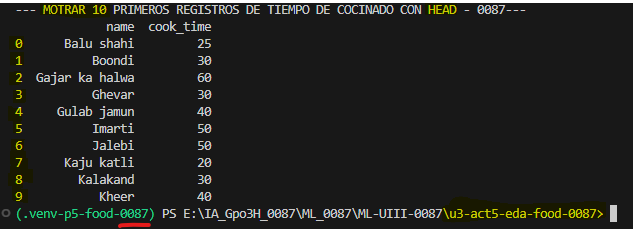
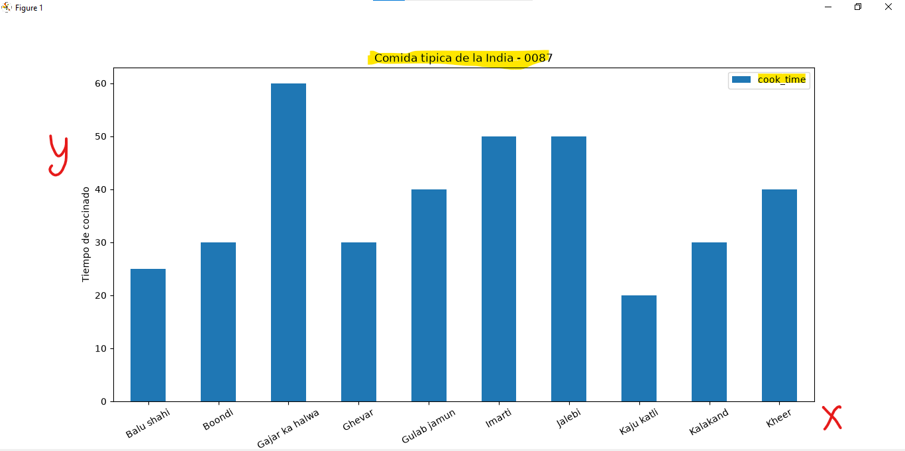
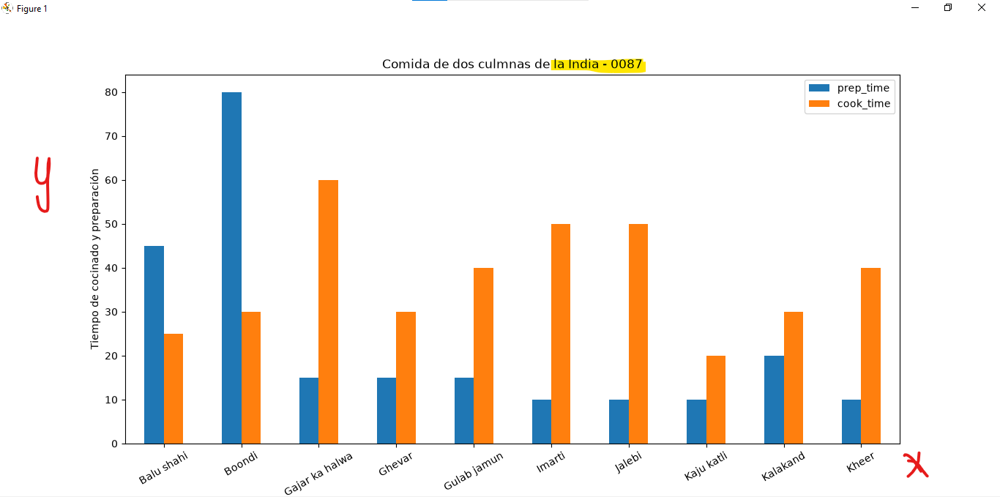
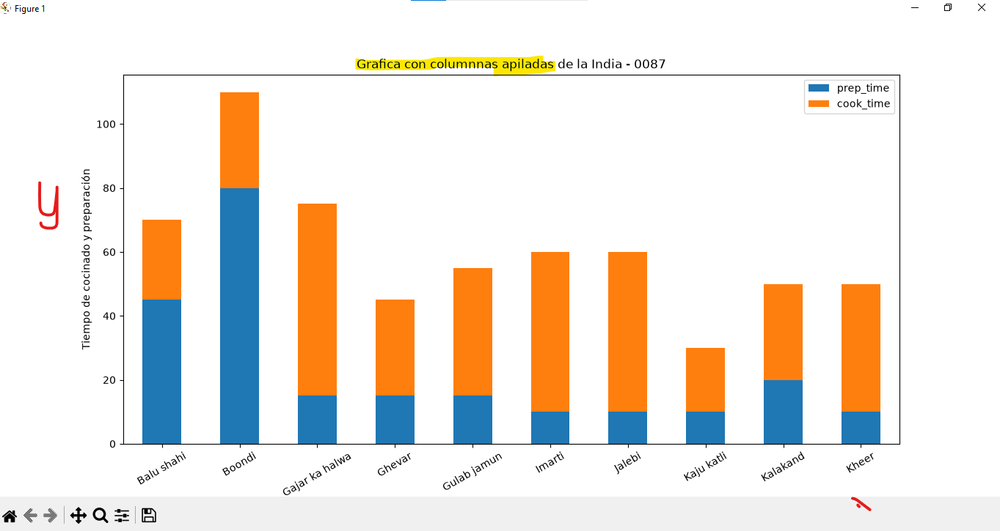

## Analisis exploratorio de datos 
## Comida pais India
## Alonso López García  NC = 0087

### ---- Importando datos de CSV comida de India - 0087 ----

### ---- Mostrar Nombre Comida + Ingredentes 

### ---- Mostrar tiempo de cocinado 

### Creación de gráficas 

### Grafica de varias columnas 

### Graficas apiladas verticalmente 

### 